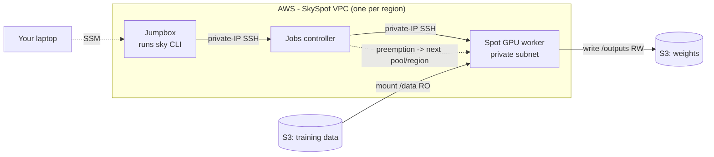

# SkySpot: Cost-Optimized GPU Workloads on AWS Spot with SkyPilot

SkySpot is a reference implementation for running GPU training and inference
workloads on **Amazon EC2 Spot** capacity using [SkyPilot](https://docs.skypilot.ai).
It combines ready-to-use infrastructure (Terraform) with four opinionated job
templates so teams can fine-tune and serve large language models at a fraction of
on-demand cost, under a hard price ceiling, with multi-region spot failover (three
regions by default, or a single region for the smallest footprint).

## Contents
- [Overview](#overview)
- [Architecture](#architecture)
- [How the layers fit together](#how-the-layers-fit-together)
- [Repository structure](#repository-structure)
- [Prerequisites](#prerequisites)
- [Getting started](#getting-started)
- [Recipes](#recipes)
- [Regions, price cap, and failover](#regions-price-cap-and-failover)
- [Design decisions](#design-decisions)
- [Cost](#cost)
- [Security](#security)
- [Cleanup](#cleanup)
- [Disclaimer](#disclaimer)

## Overview

EC2 Spot capacity is typically 70-90% cheaper than on-demand, but it can be
reclaimed at short notice and availability varies by region and instance type.
SkySpot makes that trade-off practical: you declare *what* a job needs (for
example, one L4-class GPU on spot under 2 USD/hour), and SkyPilot selects the
cheapest available capacity pool across several AWS regions, provisions it, and
re-launches the job elsewhere if the instance is reclaimed.

Workloads run in private subnets with no public IP addresses. You drive SkyPilot
from a small **jumpbox inside the VPC** (reached from your laptop over AWS Systems
Manager Session Manager); from there SkyPilot connects to the controller and
workers over direct private-IP SSH. Training datasets and model weights are stored
in Amazon S3, so results survive interruptions.

> Why a jumpbox and not your laptop? SkyPilot's managed-jobs controller connects
> to workers over SSH; from an in-VPC client that SSH goes over private IPs and
> works, but routing it through SSM (the only option from an outside laptop into
> private subnets) fails the SSH handshake. Running sky on the in-VPC jumpbox with
> `use_ssm: false` is the configuration we verified end to end. See
> [`docs/how-it-works.md`](docs/how-it-works.md).

Use SkySpot to:
- Fine-tune a model on a single GPU or on a single multi-GPU node.
- Serve a small model (single GPU) or a large model across multiple GPU nodes.
- Do all of the above on spot, with a price cap and automatic region failover.

## Architecture



For the network-level detail (NAT, VPC endpoints, data flow) see
[`docs/architecture.md`](docs/architecture.md). For the exact region-selection,
price-cap, and failover behavior see [`docs/how-it-works.md`](docs/how-it-works.md).

## How the layers fit together

SkySpot is a thin, opinionated layer on top of SkyPilot. The split of
responsibility is deliberate:

| Layer | Responsibility |
|-------|----------------|
| **SkyPilot** (the engine) | Orchestration: the cross-region optimizer that finds the cheapest GPU under the price cap, instance provisioning and teardown, spot management with automatic preemption recovery, mounting S3 into jobs, multi-node clusters (Ray), and the SkyServe serving layer. Installed with `pip`. The `*.sky.yaml` files are SkyPilot's native format. |
| **SkySpot** (this repo) | AWS packaging around SkyPilot: Terraform for the VPC, S3 buckets, and the jumpbox that runs sky *inside* the VPC (pre-installed, with the direct-SSH `use_ssm: false` config that makes private-VPC spot actually work); four job templates with sensible GPU, region, price-cap, and dependency choices; and a preflight check plus documentation. |

In short, SkyPilot decides *where and how* a job runs; this repository provides the
*network, storage, and job definitions* to point it at, pre-wired for AWS spot.

## Repository structure

```
SkySpot/
├── config/     # SkyPilot config template (the jumpbox writes this automatically)
├── infra/
│   ├── vpc/              # VPC, one per region (NAT, S3 + SSM endpoints)
│   ├── data/             # training + weights buckets in the primary region
│   ├── data-replication/ # secondary-region buckets + CRR of the training data
│   ├── peering/          # inter-region VPC peering (controller -> failed-over worker)
│   └── jumpbox/          # the in-VPC sky control host
├── recipes/    # Four workloads (training x2, serving x2)
├── scripts/    # Preflight validation
└── docs/       # Architecture, region/failover behavior, cost guidance
```

## Prerequisites

- An AWS account with permissions to create VPC, EC2, S3, and IAM resources.
- EC2 **spot quota** for your target GPU families in your chosen regions. Large
  instance types (for example P5/P6) often require a quota increase and, for
  opt-in regions, enabling the region on the account.
- On your **laptop** (used only to provision and to reach the jumpbox):
  [Terraform 1.5+](https://developer.hashicorp.com/terraform/downloads),
  [AWS CLI v2](https://docs.aws.amazon.com/cli/latest/userguide/getting-started-install.html),
  and the
  [Session Manager plugin](https://docs.aws.amazon.com/systems-manager/latest/userguide/session-manager-working-with-install-plugin.html).
- You do **not** install SkyPilot on your laptop - it runs on the jumpbox, which
  pre-installs it.

## Getting started

The recipes ship for **three regions** (`eu-north-1`, `ap-south-1`, `us-east-1`),
so the default setup deploys all three with cross-region data replication and VPC
peering, giving you real multi-region spot failover. **One region is also fully
supported** and is the smallest footprint - see
[Single-region setup](#single-region-setup) below. Either way this provisions
billable resources (one NAT gateway per region, the jumpbox, and a spot GPU); see
[Cost](#cost) and [Cleanup](#cleanup).

### Three-region setup (default)

The first region is the **primary**: it hosts the jumpbox, the SkyPilot controller,
and the source data bucket. The other two are **secondaries** the jobs fail over
into.

**On your laptop - provision the environment:**
```bash
PRIMARY=eu-north-1; SEC1=ap-south-1; SEC2=us-east-1

# 1. A VPC in each region. Distinct, non-overlapping CIDRs, one Terraform
#    workspace per region (see infra/vpc/README.md for the CIDR table).
cd infra/vpc && terraform init
terraform workspace new $PRIMARY && terraform apply -var="region=$PRIMARY" -var="vpc_cidr=10.10.0.0/16"
terraform workspace new $SEC1    && terraform apply -var="region=$SEC1"    -var="vpc_cidr=10.11.0.0/16"
terraform workspace new $SEC2    && terraform apply -var="region=$SEC2"    -var="vpc_cidr=10.13.0.0/16"
cd ../..

# 2. Peer the primary VPC to each secondary (so the controller can reach a worker
#    that failed over to another region). CIDRs must be the distinct ones above.
cd infra/peering && terraform init && terraform apply \
  -var="primary_region=$PRIMARY" -var="secondary_region_1=$SEC1" -var="secondary_region_2=$SEC2"
cd ../..

# 3. Data buckets in the primary region, then cross-region replication to the
#    secondaries. Apply replication BEFORE loading data so CRR copies it.
cd infra/data && terraform init && terraform apply -var="region=$PRIMARY" && cd ../..
cd infra/data-replication && terraform init && terraform apply \
  -var="primary_region=$PRIMARY" -var="secondary_region_1=$SEC1" -var="secondary_region_2=$SEC2" && cd ../..
cd infra/data && ./init-data.sh "$(terraform output -raw training_bucket)" 1000 $PRIMARY && cd ../..

# 4. Jumpbox in the primary region (the sky control host; waits ~2-3 min). Its
#    region also pins the SkyPilot controller here.
cd infra/jumpbox && terraform init && terraform apply -var="region=$PRIMARY"
JB=$(terraform output -raw instance_id); cd ../..

# 5. Open a shell on the jumpbox
aws ssm start-session --target "$JB" --region $PRIMARY
```

**On the jumpbox - run the job (sky is pre-installed and configured for direct SSH):**
```bash
sky check aws
cd <repo-on-jumpbox>                                        # clone this repo or scp recipes/ over
./scripts/preflight.sh skyspot-vpc "eu-north-1 ap-south-1 us-east-1"
sky jobs launch -n ft-single recipes/01-finetune-single-gpu/finetune.sky.yaml -y
sky jobs queue && sky jobs logs ft-single
```

You do **not** edit bucket names into the recipe: it resolves its region-local
bucket (`skyspot-training-<account>-<region>`) at runtime. If you deployed
`infra/data` with a non-default `name_prefix`, set `envs.BUCKET_PREFIX` in the
recipe to match. The trained adapter is written to the weights bucket of whichever
region the job ran in: `s3://skyspot-weights-<account>-<region>/runs/<run-id>/`.

### Single-region setup

Smallest footprint - one VPC, no peering, no replication. Deploy only `infra/vpc`
(once), `infra/data`, and `infra/jumpbox` in that one region, then **trim each
recipe's `any_of:` to that single region**:
```bash
R=eu-north-1
cd infra/vpc  && terraform init && terraform workspace new $R && terraform apply -var="region=$R" -var="vpc_cidr=10.10.0.0/16" && cd ../..
cd infra/data && terraform init && terraform apply -var="region=$R" && ./init-data.sh "$(terraform output -raw training_bucket)" 1000 $R && cd ../..
cd infra/jumpbox && terraform init && terraform apply -var="region=$R" && cd ../..
# In each recipe you run, cut any_of: down to the one region R.
```
The runtime bucket resolution still works (there is just one region), so the
recipe is otherwise unchanged. Skip `infra/peering` and `infra/data-replication`
entirely.

**Choosing a recipe:**

```
Training?
  ├─ Fits on 1 GPU ............................  recipe 01
  └─ Needs several GPUs on one machine .......  recipe 02
Serving?
  ├─ Small model (3-8B), fits on 1 GPU .......  recipe 03
  └─ Large model, needs several nodes ........  recipe 04
```

Each recipe folder contains its own README with exact commands, output locations,
and (for serving) how to test the endpoint.

## Recipes

Each recipe is self-contained: a SkyPilot task file (`*.sky.yaml`), an optional
training script, and a README.

**[01 - Single-GPU fine-tune](recipes/01-finetune-single-gpu/)** - 1 GPU (g7e/g6/g5)
LoRA fine-tune of a small model on one spot GPU. Reads training data from S3 and
writes the adapter back to S3. Typically lands on an L4 or A10G at roughly
0.18-0.25 USD/hour and completes a 1,000-row sample in minutes. The recommended
starting point.

**[02 - Multi-GPU fine-tune, single node](recipes/02-finetune-multi-gpu-single-node/)** - 8 GPUs, 1 node
The same workflow on an 8-GPU instance (`*.48xlarge`) using `torchrun`
data-parallel, for larger models or faster epochs. All GPUs are co-located on one
machine (NVLink/PCIe), so no multi-node networking is involved.

**[03 - Serve a small LLM](recipes/03-serve-small-llm/)** - 1 GPU, vLLM
Serves `Qwen/Qwen3.5-4B` behind an OpenAI-compatible API using SkyServe on one spot
GPU, with an on-demand fallback replica so the endpoint stays reachable. Tested
locally through the SSM jumpbox.

**[04 - Serve a large LLM, multi-node](recipes/04-serve-large-llm-multinode/)** - 2 nodes x 8 H200 + EFA
Serves `zai-org/GLM-5.3` (~1.5 TB in BF16) across **two 8x H200 nodes** (`p5en`)
joined by EFA, running vLLM over Ray, for a model too large for one node. Expect
scarcer capacity and a longer first load; review its README on quotas before launching.

| # | GPUs | Instances |
|---|------|-----------|
| 01 | 1 | g7e / g6 / g5 |
| 02 | 8 (1 node) | g7e / g6 / g5 `.48xlarge` |
| 03 | 1 | g7e / g6 / g5 |
| 04 | 16 (2 nodes) | p5en (H200 x8) x2 + EFA |

## Regions, price cap, and failover

All recipes run on spot with a per-node price cap. Each recipe pins its own region
list in the `any_of:` block of its `*.sky.yaml` (shipped default: `eu-north-1`,
`ap-south-1`, `us-east-1`); within that list SkyPilot auto-selects the cheapest
available pool. That `any_of:` block is what you edit to change regions. For which
GPU families are available where, see the catalog in
[`docs/how-it-works.md`](docs/how-it-works.md).

A VPC must exist in **every** region a recipe's `any_of:` lists (the preflight
script enforces this). For a single region, failover happens in-region
automatically. For cross-region failover in the managed-job recipes (01/02), the
controller must be able to reach a worker that landed in another region. Three
pieces make that work, all shipped as Terraform:

1. **`infra/vpc` per region** - a `skyspot-vpc` with a distinct, non-overlapping CIDR.
2. **`infra/peering`** - hub-and-spoke VPC peering from the primary VPC to each
   secondary, with routes both ways, so the controller's direct private-IP SSH has
   a path to a failed-over worker. (Serving recipes 03/04 keep a replica within one
   region, so they do not need peering.)
3. **`infra/data-replication`** - cross-region replication of the training bucket,
   plus the per-region weights buckets, so a job reads and writes buckets in
   whatever region it lands in (the recipe resolves the bucket name at runtime).

See [Getting started](#getting-started) for the exact apply order (three-region and
single-region), and [`docs/how-it-works.md`](docs/how-it-works.md) for adding a
*fourth* region and for the precise selection order, price-cap filtering, and
preemption-recovery behavior.

## Design decisions

- **Virtual machines, not Kubernetes.** The simplest operational model; there is no
  cluster to run.
- **Private subnets with SSM access.** No public IP addresses and no inbound SSH;
  SkyPilot and test traffic reach instances through Session Manager.
- **S3-backed outputs.** Training checkpoints stream to S3, so a spot interruption
  does not lose completed work.
- **vLLM for serving.** Provides an OpenAI-compatible API for both serving recipes.

## Cost

The main cost drivers are the GPU instances and the per-region NAT gateway (billed
hourly plus per-GB while it exists). Managed training jobs auto-terminate their GPU
cluster on completion; serving services, interactive clusters, the jumpbox, and the
VPC must be removed explicitly. See [`docs/cost-and-spot.md`](docs/cost-and-spot.md)
for per-recipe price caps and spot behavior, and always run [Cleanup](#cleanup) when
finished.

## Security

- Workloads run in private subnets with no public IP addresses; access is via SSM
  Session Manager, not inbound SSH.
- S3 buckets created by this repo block public access and enable server-side
  encryption.
- The jumpbox runs the `sky` CLI, so its IAM role is intentionally broad:
  `AmazonSSMManagedInstanceCore` (for Session Manager access) plus
  `AmazonEC2FullAccess`, `AmazonS3FullAccess`, and an inline policy that lets
  SkyPilot create and pass the `skypilot-v1` instance role. This is convenient for
  a sandbox, not least privilege.
- Review and tighten IAM permissions (scope the EC2/S3 grants to what your recipes
  actually touch) before using in production.

## Cleanup

Remove resources in reverse order of creation to avoid dependency errors. For the
three-region setup (set `PRIMARY`/`SEC1`/`SEC2` as during setup):

```bash
sky serve down <name>          # any running services
sky down <cluster>             # any interactive clusters

# Jumpbox (primary region only)
cd infra/jumpbox && terraform destroy -var="region=$PRIMARY" && cd ../..

# Peering + replicated secondary buckets (skip if single-region)
cd infra/peering && terraform destroy \
  -var="primary_region=$PRIMARY" -var="secondary_region_1=$SEC1" -var="secondary_region_2=$SEC2" && cd ../..
cd infra/data-replication && terraform destroy \
  -var="primary_region=$PRIMARY" -var="secondary_region_1=$SEC1" -var="secondary_region_2=$SEC2" && cd ../..

# Primary data buckets
cd infra/data && terraform destroy -var="region=$PRIMARY" && cd ../..

# VPCs - once per region/workspace
cd infra/vpc
for R in $PRIMARY $SEC1 $SEC2; do terraform workspace select $R && terraform destroy -var="region=$R"; done
cd ../..
```

For a single-region setup, destroy only `infra/jumpbox`, `infra/data`, and the one
`infra/vpc` workspace; there is no peering or replication to remove.

Managed training jobs terminate their own GPU clusters on completion. The SkyPilot
jobs controller persists between runs (it autostops when idle); when you no longer
need it, find its name with `sky status` and remove it with
`sky down sky-jobs-controller-<hash>` (you will be prompted to type `delete`).

**If a VPC destroy fails with `DependencyViolation`:** SkyPilot creates its own
per-cluster security groups (`sky-sg-*`) inside the VPC that Terraform does not
manage, and they block the VPC delete after clusters are gone. Delete them, then
re-run the destroy:
```bash
aws ec2 describe-security-groups --region <r> \
  --filters "Name=vpc-id,Values=<vpc-id>" \
  --query 'SecurityGroups[?starts_with(GroupName,`sky-sg-`)].GroupId' --output text \
  | xargs -n1 aws ec2 delete-security-group --region <r> --group-id
```

## Disclaimer

This is sample code intended to demonstrate a pattern. Review and adapt it for your
own security, quota, and cost requirements before production use. You are
responsible for the AWS charges it incurs.

# LICENSE

MIT No Attribution

Permission is hereby granted, free of charge, to any person obtaining a copy of
this software and associated documentation files (the "Software"), to deal in
the Software without restriction, including without limitation the rights to
use, copy, modify, merge, publish, distribute, sublicense, and/or sell copies of
the Software, and to permit persons to whom the Software is furnished to do so.

THE SOFTWARE IS PROVIDED "AS IS", WITHOUT WARRANTY OF ANY KIND, EXPRESS OR
IMPLIED, INCLUDING BUT NOT LIMITED TO THE WARRANTIES OF MERCHANTABILITY, FITNESS
FOR A PARTICULAR PURPOSE AND NONINFRINGEMENT. IN NO EVENT SHALL THE AUTHORS OR
COPYRIGHT HOLDERS BE LIABLE FOR ANY CLAIM, DAMAGES OR OTHER LIABILITY, WHETHER
IN AN ACTION OF CONTRACT, TORT OR OTHERWISE, ARISING FROM, OUT OF OR IN
CONNECTION WITH THE SOFTWARE OR THE USE OR OTHER DEALINGS IN THE SOFTWARE.
